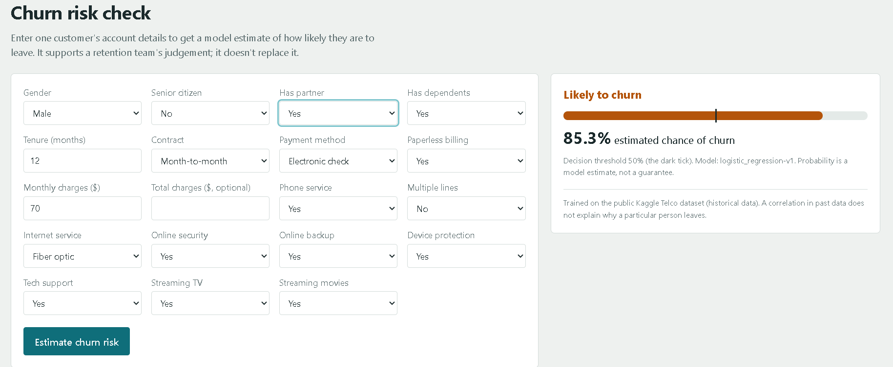
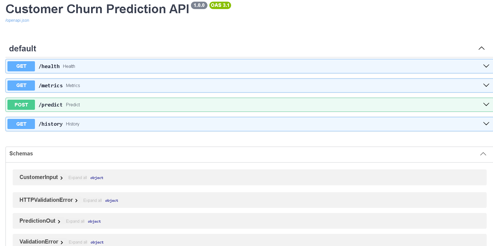
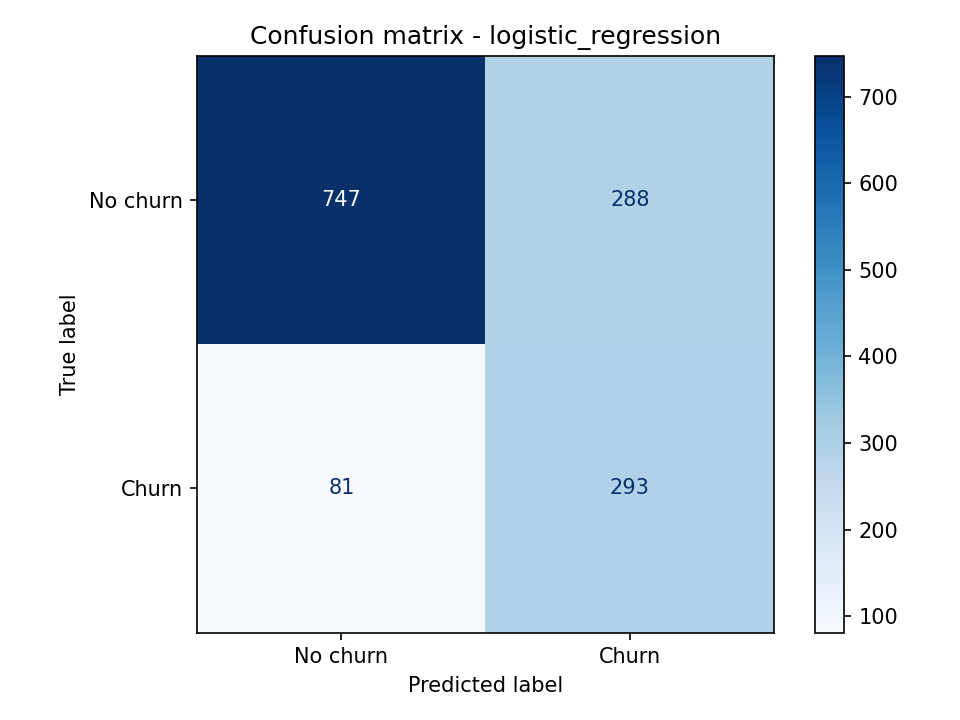

# AI-Powered Customer Churn Prediction System

Predicts whether a telecom customer is likely to churn, using the Kaggle **Telco Customer Churn** dataset.
Stack: Python, pandas, scikit-learn, FastAPI, SQLite, plain HTML/JS.

## Screenshots





> The dataset is historical. The app makes live predictions on data you type in, but it is not connected to any real telecom system.

## Project layout
```
customer-churn-ai/
├── data/raw/            # put the Kaggle CSV here (not committed)
├── notebooks/01_eda.ipynb
├── src/train.py         # train, compare, save pipeline + metrics
├── models/              # churn_pipeline.joblib, metrics.json (generated)
├── app/                 # FastAPI service + web UI
│   ├── main.py  schemas.py  database.py
│   └── static/          # index.html, style.css, app.js
├── tests/test_api.py
├── reports/figures/     # charts saved from EDA / training
└── requirements.txt
```

## Setup (Windows PowerShell)
```powershell
python -m venv .venv
.venv\Scripts\Activate.ps1
pip install -r requirements.txt
```
(macOS/Linux: `source .venv/bin/activate`)

## Run it
1. Download the dataset from https://www.kaggle.com/datasets/blastchar/telco-customer-churn and save it as
   `data/raw/WA_Fn-UseC_-Telco-Customer-Churn.csv`.
2. EDA: open `notebooks/01_eda.ipynb` in VS Code and run all cells.
3. Train: `python -m src.train`
   Prints CV scores, test metrics and the confusion matrix, and writes `models/churn_pipeline.joblib` and `models/metrics.json`.
4. Start the app: `uvicorn app.main:app --reload`
   - Web UI: http://127.0.0.1:8000
   - API docs: http://127.0.0.1:8000/docs
5. Test: `pytest -q`

## API
| Method | Path | Purpose |
|---|---|---|
| GET | `/health` | Is the service up and the model loaded? |
| POST | `/predict` | Customer JSON in -> class + probability out (saved to SQLite) |
| GET | `/history?limit=10` | Latest saved predictions |
| GET | `/metrics` | Metrics from the last training run |

## Design notes
- The data is split **before** any fitting; imputing, scaling and encoding live inside one scikit-learn `Pipeline`, so there is no test-set leakage.
- Candidates (a baseline, logistic regression, random forest) are compared with 5-fold CV on the training set only; the test set is used once.
- `TotalCharges` is blank for brand-new customers in the raw file; it is converted to numeric and imputed inside the pipeline.
- The decision threshold defaults to 0.5. Set `CHURN_THRESHOLD` to change it; pick it from the cost of missed churners vs wasted offers.
- Only contract, tenure, monthly charges and the result are stored in SQLite, to keep personal data minimal.

## Results

Measured on a held-out 20% test set (1,409 customers, stratified split, random_state=42).

| Metric | Value |
|---|---|
| Selected model | Logistic Regression |
| Test ROC-AUC | 0.841 |
| Test PR-AUC | 0.633 |
| Churn recall | 0.783 |
| Churn precision | 0.504 |
| Churn F1 | 0.614 |
| Accuracy | 0.738 |

Cross-validation ROC-AUC on the training set: Logistic Regression 0.846, Random Forest 0.837, baseline 0.500.
The model was selected using cross-validation on the training set only. The test set was used once.

Confusion matrix (threshold 0.50): 747 true negatives, 288 false positives, 81 false negatives, 293 true positives.

Accuracy alone is misleading here: always predicting "No churn" would be right for about 73.5% of this test set (1,035 of 1,409 customers) and would catch no churners. That is why recall, precision and ROC-AUC are reported.



Measured on a held-out 20% test set (stratified split, random_state=42).

| Metric | Value |
|---|---|
| Selected model | ___ |
| Test ROC-AUC | ___ |
| Churn precision | ___ |
| Churn recall | ___ |
| Churn F1 | ___ |
| Accuracy | ___ |

The model was selected by 5-fold cross-validation on the training set only. The test set was used once.
A baseline that always predicts "No churn" scores 0.5 ROC-AUC.


## Deploy
Any host that runs Python web services works (e.g. Render, Railway).
- Build: `pip install -r requirements.txt && python -m src.train` (the CSV must be available at build time),
  or commit `models/churn_pipeline.joblib` and `models/metrics.json`.
- Start: `uvicorn app.main:app --host 0.0.0.0 --port $PORT`
- Free tiers have an ephemeral disk, so SQLite history may reset on restart. Set `CHURN_DB_PATH` to a persistent volume if needed.

## Limitations
Old public dataset; may not represent current customers; correlation is not causation; probabilities may be poorly calibrated; keep a human in any retention decision.

## Future work
Hyperparameter tuning, threshold optimisation from business costs, probability calibration, SHAP/permutation importance, drift monitoring, PostgreSQL, authentication, Docker, CI.
